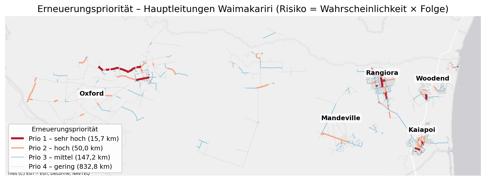
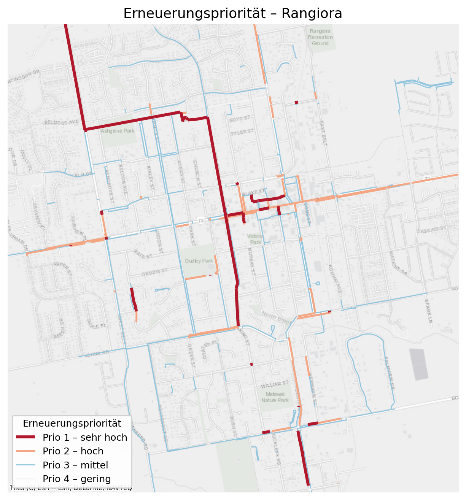
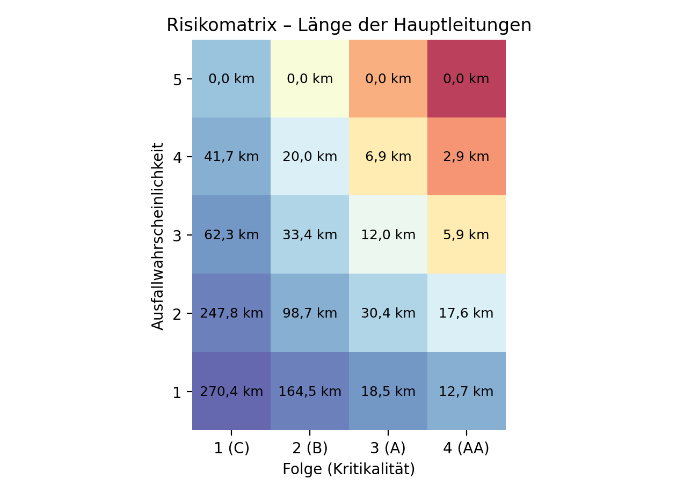
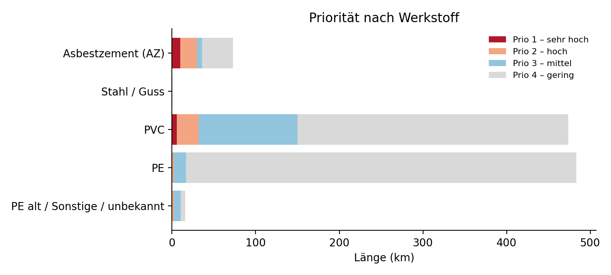
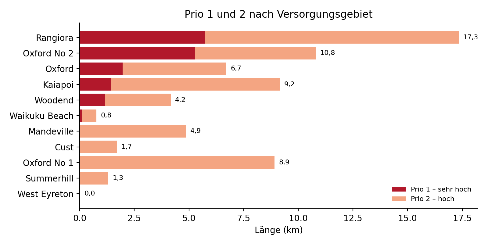
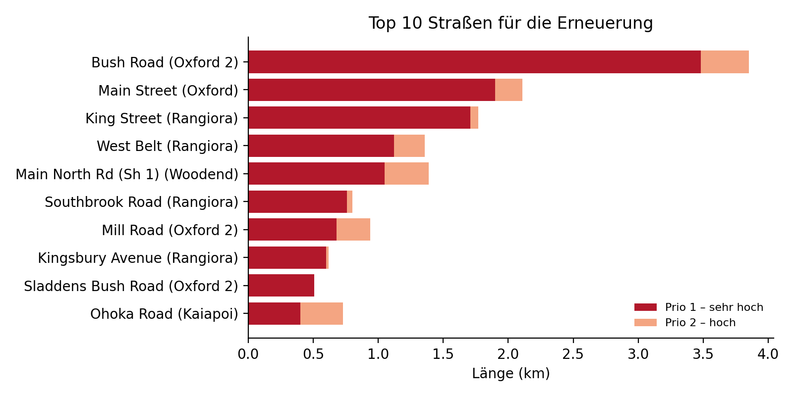

# Water Pipe Renewal Priority – Waimakariri (NZ)

[English](#water-pipe-renewal-priority--waimakariri-nz) | [Deutsch](#deutsch)

Which water mains should be renewed first? This project calculates a **risk score** for **1,046 km of network mains** of the **Waimakariri District (New Zealand)**: **likelihood of failure** (pipe age, material, condition) × **consequence of failure** (criticality). The result is a **priority class for every pipe section**, a priority map, a ranking of streets and a short **management report** – the typical renewal planning questions of a water utility's asset management.



---

## Key results

| | |
|---|---|
| Study area | Waimakariri District, Canterbury (New Zealand), 17 supply schemes |
| Network mains | **1,045.7 km** (11,319 pipe sections), service lines excluded |
| Priority 1 – very high | **15.7 km** (186 sections), 62.7 % asbestos cement, mean install year 1979 |
| Priority 2 – high | **50.0 km** |
| Priority 1 + 2 | **6.3 %** of the network length |
| Hot spots | Rangiora (5.7 km Prio 1), Oxford No 2 (5.3 km), Oxford (2.0 km) |
| Condition data | available for only **8.9 %** of the Prio 1 + 2 length |

**Length by priority class**

| Priority | Risk score | km | Share |
|---|---|---|---|
| Prio 1 – very high | ≥ 10 | 15.7 | 1.5 % |
| Prio 2 – high | 7 to < 10 | 50.0 | 4.8 % |
| Prio 3 – medium | 4 to < 7 | 147.2 | 14.1 % |
| Prio 4 – low | < 4 | 832.8 | 79.6 % |

**Top 5 streets for renewal**

| # | Street | Supply scheme | Prio 1 (km) | Main material |
|---|---|---|---|---|
| 1 | Bush Road | Oxford No 2 | 3.48 | PVC |
| 2 | Main Street | Oxford | 1.90 | asbestos cement |
| 3 | King Street | Rangiora | 1.71 | asbestos cement |
| 4 | West Belt | Rangiora | 1.12 | asbestos cement |
| 5 | Main North Rd (SH 1) | Woodend | 1.05 | asbestos cement |

**Interpretation:** the renewal need is concentrated in a small part of the network. Priority 1 consists mainly of asbestos-cement mains with high criticality (A/AA) in the centre of Rangiora and in Oxford, plus early PVC trunk mains from 1984/85 with criticality AA (Bush Road). Modern PE mains have no priority 1. As condition grades are missing for most mains, the score is based mainly on age, material and criticality. **Recommended measures:** inspect the 15.7 km of priority 1 first and record condition grades, include priority 1 in the next years of renewal planning (start with King Street, West Belt and Main Street), combine the works with planned road and sewer works and repeat the assessment every year.

| | |
|---|---|
|  |  |
|  |  |



---

## Workflow

| Factor | Points |
|---|---|
| **Age** (reference year 2026) | < 20 years = 1 · 20–39 = 2 · 40–59 = 3 · 60–79 = 4 · ≥ 80 = 5 |
| **Material** | PE = 1 · PVC = 2 · early PE / other / unknown = 3 · steel / cast iron = 4 · asbestos cement = 5 |
| **Condition** | grade 1–5 from `ASSET_CONDITION`; no grade = 3 (neutral) |
| **Likelihood of failure (1–5)** | 40 % age + 40 % material + 20 % condition |
| **Consequence of failure (1–4)** | criticality AA = 4 · A = 3 · B = 2 · C = 1 · unknown = 2 |
| **Risk (1–20)** | likelihood × consequence |

1. **Data** – water pipes loaded in QGIS from the council's public ArcGIS REST service (`3Waters / Assets_Water_Supply / Water Supply Pipe`) and saved as GeoPackage, NZGD2000 / NZTM (EPSG:2193)
2. **Filter** – network mains only (`CLASSIFICATION3 = Network Main`), service lines excluded
3. **Scores** – points for age, material and condition → likelihood of failure; criticality → consequence of failure
4. **Risk and priority** – risk = likelihood × consequence, four priority classes
5. **Lists** – priority list of all Prio 1 + 2 sections (asset ID, street, material, DN, install year, condition, criticality, points), top 20 streets, material and supply scheme × priority, risk matrix
6. **Maps, charts and report** – maps with Esri Light Gray basemap, tables as CSV/Excel, GeoPackage for QGIS, 3-page report in German (summary, method, key figures, explanation, measures)

## Limitations

- The weights and points are a simple assessment model; they do not replace an on-site condition assessment
- Condition grades are missing for most mains, so the condition has a lower weight (20 %)
- The install year is derived from the field `ACQN_DATE`
- No break or failure data are included; a break analysis is planned as analysis 3

---

## Repository structure

```
Water-Pipe-Renewal-Priority-Waimakariri/
├── notebooks/
│   └── water_pipe_renewal_priority_waimakariri.ipynb
├── images/
│   ├── 01_Erneuerungsprioritaet_Waimakariri.png
│   ├── 02_Prioritaet_Rangiora.png
│   ├── 03_Risikomatrix.png
│   ├── 04_Prioritaet_Werkstoff.png
│   ├── 05_Prioritaet_Versorgungsgebiet.png
│   └── 06_Top10_Strassen.png
├── results/
│   ├── Erneuerungsprioritaet_Waimakariri_Bericht.pdf   # report (German)
│   ├── erneuerungsprioritaet_waimakariri.xlsx          # all tables
│   ├── kennzahlen.csv
│   ├── laenge_je_prioritaet.csv
│   ├── prioritaetenliste_prio1_2.csv
│   ├── top20_strassen.csv
│   ├── versorgungsgebiet_x_prioritaet.csv
│   └── werkstoff_x_prioritaet.csv
├── requirements.txt
├── LICENSE
└── README.md
```

The notebook runs in Google Colab; the GeoPackage exported from QGIS is uploaded in step 3. The notebook also writes the result as GeoPackage (`erneuerungsprioritaet_waimakariri.gpkg`) for QGIS; like the raw data, it is not included in this repository.

## Tools

Python · pandas · GeoPandas · NumPy · Matplotlib · contextily · QGIS · ArcGIS REST · Google Colab

## Data sources

Water supply pipes: Waimakariri District Council (New Zealand), public ArcGIS REST service, retrieved 15 November 2026. The raw data are not included in this repository. Basemap: Esri World Light Gray Canvas.

## License

Code: MIT License – see [LICENSE](LICENSE)

---
---

# Deutsch

[English](#water-pipe-renewal-priority--waimakariri-nz) | [Deutsch](#deutsch)

Welche Wasserleitungen sollen zuerst erneuert werden? Dieses Projekt berechnet ein **Risiko** für **1.046 km Hauptleitungen** im **Waimakariri District (Neuseeland)**: **Ausfallwahrscheinlichkeit** (Leitungsalter, Werkstoff, Zustand) × **Folge eines Ausfalls** (Kritikalität). Das Ergebnis ist eine **Prioritätsklasse für jeden Leitungsabschnitt**, eine Prioritätenkarte, eine Rangliste der Straßen und ein kurzer **Bericht (Reporting)** – die typischen Fragen der Erneuerungsplanung im Asset-Management eines Wasserversorgers.


---

## Zentrale Ergebnisse

| | |
|---|---|
| Untersuchungsgebiet | Waimakariri District, Canterbury (Neuseeland), 17 Versorgungsgebiete |
| Hauptleitungen | **1.045,7 km** (11.319 Abschnitte), ohne Hausanschlussleitungen |
| Priorität 1 – sehr hoch | **15,7 km** (186 Abschnitte), 62,7 % Asbestzement, mittleres Baujahr 1979 |
| Priorität 2 – hoch | **50,0 km** |
| Priorität 1 + 2 | **6,3 %** der Netzlänge |
| Schwerpunkte | Rangiora (5,7 km Prio 1), Oxford No 2 (5,3 km), Oxford (2,0 km) |
| Zustandsdaten | nur für **8,9 %** der Länge von Prio 1 + 2 vorhanden |

**Länge nach Prioritätsklasse**

| Priorität | Risiko | km | Anteil |
|---|---|---|---|
| Prio 1 – sehr hoch | ≥ 10 | 15,7 | 1,5 % |
| Prio 2 – hoch | 7 bis < 10 | 50,0 | 4,8 % |
| Prio 3 – mittel | 4 bis < 7 | 147,2 | 14,1 % |
| Prio 4 – gering | < 4 | 832,8 | 79,6 % |

**Top 5 Straßen für die Erneuerung**

| # | Straße | Versorgungsgebiet | Prio 1 (km) | Hauptwerkstoff |
|---|---|---|---|---|
| 1 | Bush Road | Oxford No 2 | 3,48 | PVC |
| 2 | Main Street | Oxford | 1,90 | Asbestzement |
| 3 | King Street | Rangiora | 1,71 | Asbestzement |
| 4 | West Belt | Rangiora | 1,12 | Asbestzement |
| 5 | Main North Rd (SH 1) | Woodend | 1,05 | Asbestzement |

**Interpretation:** Der Erneuerungsbedarf konzentriert sich auf einen kleinen Teil des Netzes. Priorität 1 besteht vor allem aus Asbestzement-Leitungen mit hoher Kritikalität (A/AA) im Ortskern von Rangiora und in Oxford sowie aus frühen PVC-Hauptleitungen von 1984/85 mit Kritikalität AA (Bush Road). Moderne PE-Leitungen haben keine Priorität 1. Da für die meisten Leitungen Zustandsnoten fehlen, beruht die Bewertung vor allem auf Alter, Werkstoff und Kritikalität. **Maßnahmen:** die 15,7 km mit Priorität 1 zuerst vor Ort bewerten und Zustandsnoten erfassen, Priorität 1 in die nächsten Jahre der Erneuerungsplanung aufnehmen (zuerst King Street, West Belt und Main Street), Arbeiten mit geplanten Straßen- und Kanalbaumaßnahmen abstimmen und die Bewertung jährlich wiederholen.

---

## Arbeitsablauf

| Faktor | Punkte |
|---|---|
| **Alter** (Bezugsjahr 2026) | < 20 Jahre = 1 · 20–39 = 2 · 40–59 = 3 · 60–79 = 4 · ≥ 80 = 5 |
| **Werkstoff** | PE = 1 · PVC = 2 · PE alt / Sonstige / unbekannt = 3 · Stahl / Guss = 4 · Asbestzement = 5 |
| **Zustand** | Note 1–5 aus `ASSET_CONDITION`; ohne Note = 3 (neutral) |
| **Ausfallwahrscheinlichkeit (1–5)** | 40 % Alter + 40 % Werkstoff + 20 % Zustand |
| **Folge (1–4)** | Kritikalität AA = 4 · A = 3 · B = 2 · C = 1 · unbekannt = 2 |
| **Risiko (1–20)** | Wahrscheinlichkeit × Folge |

1. **Daten** – Wasserleitungen in QGIS aus dem öffentlichen ArcGIS-REST-Dienst des Councils geladen (`3Waters / Assets_Water_Supply / Water Supply Pipe`) und als GeoPackage gespeichert, NZGD2000 / NZTM (EPSG:2193)
2. **Filter** – nur Hauptleitungen (`CLASSIFICATION3 = Network Main`), ohne Hausanschlussleitungen
3. **Punkte** – Punkte für Alter, Werkstoff und Zustand → Ausfallwahrscheinlichkeit; Kritikalität → Folge
4. **Risiko und Priorität** – Risiko = Wahrscheinlichkeit × Folge, vier Prioritätsklassen
5. **Listen** – Prioritätenliste aller Abschnitte mit Prio 1 + 2 (Asset-ID, Straße, Werkstoff, DN, Baujahr, Zustand, Kritikalität, Punkte), Top 20 Straßen, Werkstoff und Versorgungsgebiet × Priorität, Risikomatrix
6. **Karten, Diagramme und Bericht** – Karten mit Esri-Light-Gray-Grundkarte, Tabellen als CSV/Excel, GeoPackage für QGIS, Bericht mit 3 Seiten (Kurzfassung, Methode, Kennzahlen, Erklärung, Maßnahmen)

## Einschränkungen

- Die Gewichte und Punkte sind ein einfaches Bewertungsmodell; sie ersetzen keine Zustandsbewertung vor Ort
- Für die meisten Leitungen fehlen Zustandsnoten, daher wird der Zustand geringer gewichtet (20 %)
- Das Baujahr ist aus dem Feld `ACQN_DATE` abgeleitet
- Schadensdaten (Rohrbrüche) sind nicht enthalten; eine Schadensanalyse ist als Analyse 3 geplant

---

## Werkzeuge

Python · pandas · GeoPandas · NumPy · Matplotlib · contextily · QGIS · ArcGIS REST · Google Colab

## Datenquellen

Wasserleitungen: Waimakariri District Council (Neuseeland), öffentlicher ArcGIS-REST-Dienst, abgerufen am 15.11.2026. Die Rohdaten sind nicht im Repository enthalten. Grundkarte: Esri World Light Gray Canvas.

## Lizenz

Code: MIT-Lizenz – siehe [LICENSE](LICENSE)
